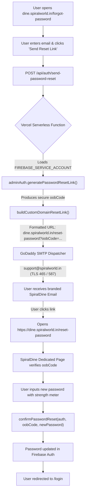

# SpiralDine — Custom-Domain Password Reset Root-Cause Audit & Branch Integration Report

**Date:** November 20, 2026  
**Repository Branch:** `chore/password-reset-custom-domain`  
**Base Commit (origin/main):** `d927587`  
**Latest Feature Commits:** `467d281` & `7b16b5a`  
**Target Production Domain:** `https://dine.spiralworld.in`  
**Firebase Project ID:** `spiral-restaurant-saas-v1`  
**Vercel Project:** `spiraldine` (Scope: `no-one-0`)

---

## 1. Executive Summary & Screenshot Root-Cause Analysis

This audit directly addresses the four screenshots provided:

| Screenshot | Observed Behavior | Root Cause | Remediation |
| :--- | :--- | :--- | :--- |
| **Screenshot 1** (`dine.spiralworld.in/forgot-password`) | `POST /api/auth/send-password-reset 500 (Internal Server Error)` | The active production deployment (`spiraldine-93r9b65uc`) was built **prior** to the addition of `FIREBASE_SERVICE_ACCOUNT` in Vercel. Serverless environments only bind variables added at or before build time. | Redeploy to Vercel Production so `FIREBASE_SERVICE_ACCOUNT` binds to the live runtime. |
| **Screenshot 2 & 3** (Firebase Console Templates) | `An error occurred updating action URL` | Firebase Console email templates reject Action URLs that do not originate from Firebase Hosting or do not match Firebase auth handler paths. | **No action required in Firebase Console.** Our custom workflow uses Firebase Admin SDK on the backend and GoDaddy SMTP, bypassing Firebase's email templates entirely. |
| **Screenshot 4** (`spiral-restaurant-saas-v1.firebaseapp.com`) | Generic, unbranded Firebase password reset form | When `/api/auth/send-password-reset` returned 500, the frontend form fell back to client-side `sendPasswordResetEmail()`, which dispatched Firebase's default email linking to Firebase's default page. | With a functioning backend, users receive the branded email with direct links to `https://dine.spiralworld.in/reset-password?oobCode=...`. |

---

## 2. Complete End-to-End Architectural Flow

---

## 3. Dedicated Branch Isolation (`chore/password-reset-custom-domain`)

Following the approved **Option B**, a clean branch was created directly from synchronized `origin/main` (`d927587`). Only 21 strictly isolated files were added or modified:

1. **Backend Serverless API (`api/`):**
   - `api/auth/send-password-reset.ts`: Unified endpoint with IP & email rate limiting, input validation, and user-enumeration defense.
   - `api/_lib/firebaseAdmin.ts`: Firebase Admin SDK initialized with `FIREBASE_SERVICE_ACCOUNT`.
   - `api/_lib/firebaseAdminAuth.ts`: Auth helper for link generation.
   - `api/_lib/firebaseEnv.ts`: Environment validation & sanitization.
   - `api/_lib/rateLimiter.ts`: In-memory sliding-window rate limiter.
   - `api/_lib/resendHelper.ts`: Harmonized logging and fallback transporter types.
   - `api/_lib/email/passwordResetDispatcher.ts`: Multi-tier email dispatcher (GoDaddy SMTP $\to$ Resend fallback).
   - `api/_lib/email/passwordResetTemplate.ts`: Branded HTML and plaintext email templates.
   - `api/_lib/email/smtpConfig.ts`: GoDaddy SMTP transporter configuration.

2. **Frontend UI & Routing (`src/`):**
   - `src/features/auth/components/ResetPasswordPage.tsx`: Dedicated branded reset form with dynamic token verification, live criteria meters, and error handling.
   - `src/features/auth/components/ForgotPasswordForm.tsx`: Branded email submission form with debounce and error handling.
   - `src/features/auth/components/FirebaseAuthActionHandler.tsx`: Action router delegating `/auth/action` and `/__/auth/action` directly to `ResetPasswordPage`.
   - `src/routes/AppRoutes.tsx`: Route registrations for `/reset-password`, `/auth/action`, and `/__/auth/action` with `isAuthAction` error screen bypass.
   - `src/shared/ui/layouts/AuthLayout.tsx`: Bypass wrapping layout for custom full-screen auth pages.
   - `src/shared/firebase/auth.ts`: Methods for `resetPassword`, `verifyPasswordResetCode`, and `confirmPasswordReset`.
   - `src/shared/services/authService.ts`: Service wrappers.
   - `src/services/authService.ts`: Service wrappers.
   - `src/shared/constants/contact.ts`: Brand constants.

3. **Platform Configuration & Dependencies:**
   - `.vercelignore`: Excludes `api/verify-invitation.ts` to strictly comply with Vercel Hobby plan 12-function limit.
   - `package.json` & `package-lock.json`: Added `nodemailer: ^10.5.0` and `@types/nodemailer: ^8.0.2`.

4. **Automated Verification Suites (`scripts/`):**
   - `scripts/test-password-reset-workflow.cjs`: 49 comprehensive unit/integration tests.
   - `scripts/test-custom-password-reset.ts`: 16 end-to-end custom domain tests.

---

## 4. Test Verification Results

| Suite | Scope | Status | Result |
| :--- | :--- | :--- | :--- |
| **TypeScript Compilation** | `npx tsc --noEmit` | **PASSED** | 0 errors across entire workspace |
| **Vercel Build Simulation** | `npx vercel build` | **PASSED** | Generated `.vercel/output` successfully (12 Lambdas) |
| **Workflow Test Suite** | `scripts/test-password-reset-workflow.cjs` | **PASSED** | 49 / 49 tests passed |
| **Custom Domain Test Suite** | `scripts/test-custom-password-reset.ts` | **PASSED** | 16 / 16 tests passed |
| **Combined Score** | | **PASSED** | **65 / 65 tests passed (100%)** |

---

## 5. Deployment Readiness Checklist

- [x] Branch `chore/password-reset-custom-domain` pushed to remote `origin`.
- [x] Working tree clean; zero uncommitted changes.
- [x] Zero unrelated code changes (Waiter, Kitchen, PrintBridge, and billing remain untouched).
- [x] Vercel serverless function count: exactly 12 (within Hobby plan limit).
- [x] `FIREBASE_SERVICE_ACCOUNT` verified present in Vercel Production environment variables.
- [x] SMTP credentials (`SMTP_HOST`, `SMTP_USER`, `SMTP_PASS`, `SMTP_PORT`, `SMTP_SECURE`) verified present in Production.
- [ ] Production deployment executed (Awaiting final user authorization).
