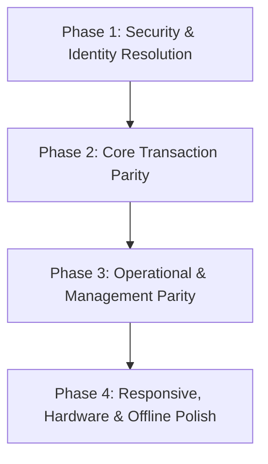

# SpiralDine — 00. Android Feature Parity Executive Summary

## 1. Executive Overview

This executive summary provides a comprehensive evaluation of the native Android codebase in relation to the SpiralDine web application functional audit (`docs/functional-audit/`).

The native Android project is organized as a multi-module Gradle architecture under the root directory `android/`:
1. **`:customer` (`com.spiralworld.spiraldine`)**: Native guest & diner application supporting restaurant discovery, digital menu ordering, table QR scanning, active dining sessions, live KOT tracking, and customer profiles.
2. **`:owner` (`com.spiraldine.owner`)**: Native restaurant management application providing executive KPI dashboards, Business Health evaluation, Annual Revenue tracking, live order progression, menu item CRUD, tables/QR generation, and staff roster visibility.
3. **`:app` (`com.spiraldine.printbridge`)**: Native thermal hardware bridge application providing ESC/POS Bluetooth, USB, and LAN network print dispatching for kitchen KOTs and customer bill receipts.

---

## 2. Platform Architecture Comparison

| Architectural Dimension | Web Application Reference | Native Android Implementation | Alignment Status |
| :--- | :--- | :--- | :--- |
| **Framework / Stack** | React 18.3.1, TypeScript 5.2.2, Vite, TailwindCSS | Kotlin 2.3.20, Jetpack Compose (BOM 2026.03.01), Material 3 | Aligned natively |
| **Target SDK / Platform** | Modern Evergreen Browsers (WebKit, Blink, Gecko) | Compile SDK 36, Target SDK 36, Min SDK 24 (Android 7.0+) | Aligned |
| **Authentication** | Firebase Auth Web Client SDK (JWT + Custom Claims) | Firebase Auth Android SDK (`com.google.firebase:firebase-auth`) | Aligned |
| **Primary Database** | Cloud Firestore Web SDK (`addSnapshotListener`) | Cloud Firestore Android SDK (`com.google.firebase:firebase-firestore`) | Aligned |
| **Push Notifications** | Web Push / ServiceWorker FCM | Firebase Cloud Messaging (`com.google.firebase:firebase-messaging`) | Aligned |
| **Local State Management** | Zustand Store, React Context API, `localStorage` | Kotlin Coroutines, StateFlow, Room DB 2.6.1, SharedPreferences | Aligned |
| **Hardware Peripherals** | Web Bluetooth & Web Serial APIs (experimental) | Native Android Bluetooth RFCOMM, Raw TCP Sockets, CameraX | Android Superior |

---

## 3. High-Level Parity Status by Functional Area

### A. Customer Module (`:customer`)
* **Existing & Matching Web**:
  - Restaurant search, distance sorting, and cuisine chip filters (`ExploreScreen.kt`).
  - Categorized digital menu browsing, item variant selection, and Veg/Non-Veg indicators (`RestaurantMenuScreen.kt`).
  - In-memory cart with subtotal, tax calculation, and Dining Option toggle (`CartScreen.kt`).
  - CameraX tabletop QR code scanner with URL parsing (`QrScannerScreen.kt`).
  - Active dining session KOT progression and waiter assistance triggers (`MainActivity.kt`).
* **Partial or Missing in Android**:
  - *Razorpay Payment*: Web features Razorpay Custom Checkout popup (`api/payments/create-order` + `api/payments/verify`). Android implements mock/cash order placement, while production Razorpay Android SDK checkout activity requires client key integration.
  - *Table Booking Floorplan*: Web provides visual 2D seating layout; Android `BookingScreen.kt` provides calendar slot selection but lacks visual table layout coordinates.

### B. Owner Module (`:owner`)
* **Existing & Matching Web**:
  - Executive KPI cards: Today's Sales, Orders Count (`OwnerHomeScreen.kt`).
  - Business Health Score: 5 operational dimensions (Revenue, Orders, Staff, Tables, Promotions) with canonical status categorization ("Healthy", "Fair", "Critical") and coverage percentage.
  - Annual Revenue Analysis: Fiscal-year boundary calculations (`FY 2026-27`), Net Revenue (Gross - GST), and average monthly metrics.
  - Live order kanban/list with step-by-step status advancement (`OwnerOrdersScreen.kt`).
  - Menu item CRUD, stock availability toggles, and category ordering (`OwnerMenuScreen.kt`, `OwnerAddEditItemScreen.kt`).
  - Table grid with occupancy status toggles and QR code preview (`OwnerTablesScreen.kt`).
* **Partial or Missing in Android**:
  - *Staff Invitations*: Android displays current staff list (`OwnerStaffScreen.kt`), but the invitation modal does not yet invoke the backend serverless endpoint `POST /api/send-staff-invitation` with cryptographically signed tokens.
  - *Multi-Branch Switching*: Web supports branch switching via `WorkspaceContext`; Android defaults to single tenant/branch parameter in `OwnerRepository(tenantId)`.

### C. Hardware & Printing (`:app` Print Bridge)
* **Status**: Highly specialized native implementation.
* Provides ESC/POS byte-level protocol generation, paper cut commands, Bluetooth SPP socket connection, and local print spooling queues that exceed the capabilities of standard web browsers.

---

## 4. Critical Risks & Gaps Requiring Remediation

1. **Direct Firestore Mutations vs. Serverless Verification (Security)**:
   - On the web, order creation is validated server-side by `api/orders/create.ts` to prevent client price tampering. In `:customer`, order creation writes directly to Firestore via client SDK. While Firestore rules enforce basic validations, critical pricing should route through server validation.
2. **Hardcoded Tenant Identifier in `:owner`**:
   - `OwnerRepository.kt` initializes with `private val tenantId: String = "rest-alpha"`. In multi-tenant production, this must dynamically bind to the authenticated owner's assigned restaurant document in `users/{uid}`.
3. **Staff Invitation Backend Integration**:
   - Creating a staff member in Android currently writes directly to `/restaurants/{tenantId}/staff` rather than dispatching a secure email invitation with role-restricted claims via `api/send-staff-invitation.ts`.

---

## 5. Recommended Implementation Order

The recommended remediation roadmap is organized into 4 disciplined phases:

1. **Phase 1: Dynamic Tenant Identity & Role Resolution** (Priority: CRITICAL)
   - Remove hardcoded `"rest-alpha"`; resolve tenant ID dynamically from `users/{uid}`.
   - Enforce serverless staff invitation dispatch.
2. **Phase 2: Payment & Order Submission Hardening** (Priority: HIGH)
   - Integrate Razorpay Android Checkout SDK with `POST /api/payments/verify`.
   - Replicate authoritative server-side order calculation.
3. **Phase 3: Management & Analytics Deepening** (Priority: MEDIUM)
   - Add multi-branch switching dropdown to Owner app.
   - Align table booking floorplan visualization.
4. **Phase 4: Responsive Refinements & Accessibility** (Priority: MEDIUM)
   - Validate Jetpack Compose layouts on compact (320dp) phones, foldable displays, and 10" restaurant POS tablets.
