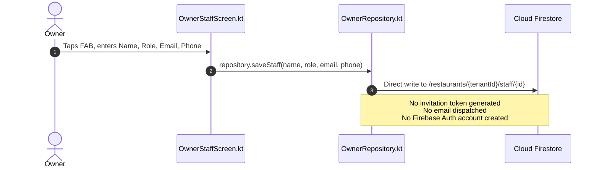
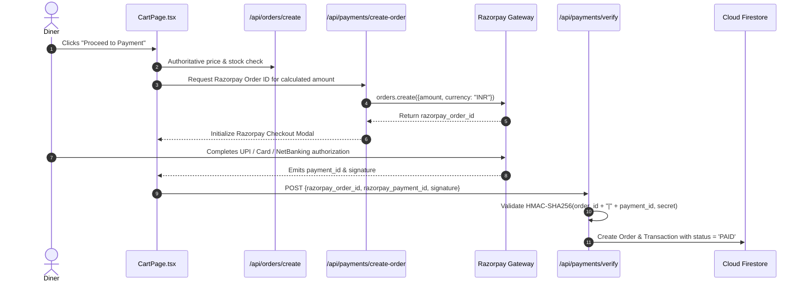
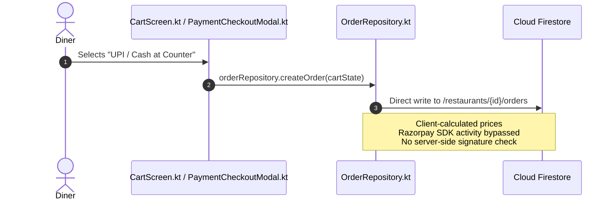

# SpiralDine — 03. Business Workflow Differences

## 1. Executive Summary

This document details every substantive discrepancy between the business workflows implemented in the SpiralDine Web Application and those implemented in the Native Android applications (`:customer`, `:owner`, and `:app`).

---

## 2. Detailed Workflow Comparison

### Workflow 1: Staff Invitation & Role-Based Onboarding

#### Canonical Web Implementation:
```mermaid
sequenceDiagram
    autonumber
    actor Owner
    participant WebUI as Owner Web UI
    participant API as /api/send-staff-invitation
    participant Firestore as Cloud Firestore
    participant Resend as Resend Email Service
    actor Staff as New Staff Member
    participant Activate as /staff/activate

    Owner->>WebUI: Enters Staff Email, Name, and Role (waiter/kitchen/manager)
    WebUI->>API: POST {email, name, role, restaurantId, branchId}
    API->>API: Generate cryptographically signed HMAC-SHA256 token
    API->>Firestore: Store invitation record in /invitations
    API->>Resend: Dispatch branded invitation email with activation link
    Resend-->>Staff: Deliver email with activation link
    Staff->>Activate: Clicks link containing token
    Activate->>Firestore: Verify token validity & role claim
    Activate->>Staff: Set password & establish Firebase Auth credentials
```

#### Native Android Implementation:


* **Discrepancy Analysis**:
  - The Android Owner implementation bypasses the secure invitation handshake.
  - While a staff record appears in the restaurant's `/staff` subcollection, the employee receives no activation email and has no Firebase Auth user account created.
  - Consequently, the employee cannot authenticate on the web or in mobile apps.
* **Remediation Required**:
  - Update `OwnerStaffScreen.kt` to trigger an HTTP POST to `https://[domain]/api/send-staff-invitation` carrying the authenticated owner's Bearer token.

---

### Workflow 2: Payment Processing & Order Verification

#### Canonical Web Implementation:


#### Native Android Implementation:


* **Discrepancy Analysis**:
  - The web application executes a rigorous 2-step server verification (authoritative order calculation + cryptographic signature verification).
  - The Android Customer application provides a cash-at-counter fallback and local mock flow, writing directly to Firestore via client SDK without invoking `api/payments/verify`.
* **Remediation Required**:
  - Integrate Razorpay Android Checkout SDK (`com.razorpay:checkout:1.6.40`) in `:customer`.
  - Handle `PaymentResultWithDataListener` in `MainActivity.kt` and dispatch the payload to `api/payments/verify.ts`.

---

### Workflow 3: Multi-Branch / Workspace Resolution

#### Canonical Web Implementation:
- Authenticated owner's user record in `/users/{uid}` contains an array of assigned branches (`assignedBranches: ['branch-01', 'branch-02']`).
- `WorkspaceContext` provides a global branch switcher in the top navigation bar.
- Selecting a branch re-binds all real-time Firestore listeners to `/restaurants/{tenantId}/branches/{branchId}`.

#### Native Android Implementation:
- `OwnerRepository.kt` defines a hardcoded default:
  ```kotlin
  class OwnerRepository(private val tenantId: String = "rest-alpha")
  ```
- No branch switcher exists in `OwnerTopBar.kt`.
- The app operates under the assumption of a single static tenant and branch.
* **Remediation Required**:
  - Fetch assigned branches from `/users/{uid}` on login.
  - Store selected `tenantId` and `branchId` in a reactive `SessionPreferences` or `StateFlow`.
  - Add branch switcher dialog to `OwnerTopBar`.

---

### Workflow 4: Table Reservation & Floorplan Experience

#### Canonical Web Implementation:
- `TableBooking.tsx` fetches table coordinates from `/restaurants/{resId}/tables`.
- Renders an interactive 2D floorplan showing table capacities, shapes (round, square, booth), and real-time availability.
- Diners select a specific table visually.

#### Native Android Implementation:
- `BookingScreen.kt` presents a calendar date picker, time slot chips, and guest count stepper.
- Users select party size, and the backend automatically assigns a table or creates an unassigned booking request.
- No visual floorplan or table coordinate renderer exists in Android Compose.
* **Remediation Required**:
  - Retain date/time slot flow as primary mobile experience.
  - Optionally introduce an interactive table selector Composable in Phase 3.

---

### Workflow 5: Password Reset & Recovery

#### Canonical Web Implementation:
- `LoginForm.tsx` includes "Forgot Password?" hyperlink.
- Prompts for email address and executes `sendPasswordResetEmail(auth, email)`.
- Displays confirmation banner directing user to check inbox.

#### Native Android Implementation:
- `OwnerLoginScreen.kt` contains Email and Password fields and a "Sign In" button.
- "Forgot Password?" action is absent from the UI.
* **Remediation Required**:
  - Add text button "Forgot password?" beneath password field in `OwnerLoginScreen.kt` invoking `FirebaseAuth.getInstance().sendPasswordResetEmail(email)`.

---

## 3. Summary of Workflow Gaps

| Business Workflow | Web Implementation | Android Implementation | Impact / Severity |
| :--- | :--- | :--- | :--- |
| **Staff Onboarding** | Serverless HMAC invitation + Email | Direct Firestore write; no email | **HIGH (P1)** |
| **Payment Verification** | Serverless HMAC-SHA256 signature check | Client-side cash/mock write | **CRITICAL (P0)** |
| **Workspace / Branch Switching** | Multi-branch dynamic selector | Hardcoded `"rest-alpha"` parameter | **HIGH (P1)** |
| **Table Reservation** | Interactive 2D floorplan selection | Calendar + Slot chips (no floorplan) | **MEDIUM (P2)** |
| **Password Recovery** | `sendPasswordResetEmail` in UI | Control absent from screen | **MEDIUM (P2)** |
| **Hardware Printing** | Experimental Web Serial/Bluetooth | Dedicated background ESC/POS spooler | **Android Superior** |
