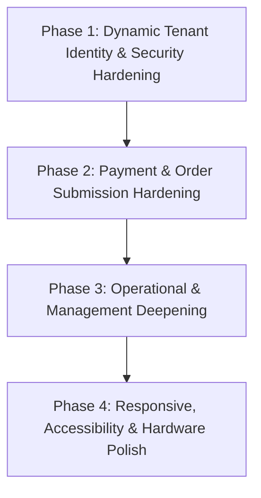

# SpiralDine — 07. Android Feature Parity Implementation Roadmap

## 1. Executive Principles & Architecture Policy

This roadmap establishes a phased, dependency-aware plan to achieve complete feature parity, security alignment, and responsive consistency across the native Android applications (`:customer`, `:owner`, and `:app`).

### Mandatory Global Implementation Requirements:
1. **Zero Fabricated Data**: Never introduce fake, mock, hardcoded, or fabricated production business data.
2. **Authoritative Sources**: Dashboard figures and reports must use authorized, genuine database or backend data.
3. **Truthful Empty States**: When data is missing, show a truthful empty or insufficient-data state.
4. **Preserve Canonical Architecture**: Preserve existing Firestore collection paths (`/restaurants/{id}/orders`, `/menu`, `/tables`) without unreviewed schema migrations.
5. **Tenant Isolation**: Preserve tenant isolation and role-based access across all queries.
6. **Backend Security Enforcement**: Enforce security on the trusted backend and Firestore rules, not solely by hiding UI buttons.
7. **Input Validation**: Validate all inputs and sensitive state transitions before database dispatch.
8. **No Secrets in APK**: Never expose private API keys, service account credentials, or HMAC secrets in client applications.
9. **Preserve Existing Capabilities**: Preserve working Android functionality; do not rewrite working modules when targeted corrections suffice.
10. **Cross-Platform Rule Parity**: Keep Android and web business calculations (Business Health, Fiscal Year Net Revenue) strictly identical.
11. **Responsive Across Form Factors**: Ensure every affected screen adapts smoothly to 320dp phones, 7"–10" tablets, landscape orientations, and large font scales.
12. **Verified Execution**: Never claim a test passed without genuine terminal or device test execution.
13. **Strict Deployment Protocol**: Do not deploy changes without explicit user authorization.

---

## 2. Phased Implementation Roadmap

---

### Phase 1: Dynamic Tenant Identity & Security Hardening (Priority: CRITICAL) — [COMPLETED]
* **Status**: **REMEDIATED & VERIFIED** (Unit Tests Passed 22/22 in `:owner`)
* **Objective**: Eliminate hardcoded tenant references, bind the owner session to verified `/users/{uid}` documents, and secure staff invitations.
* **Features Completed**:
  - Dynamic `tenantId` and `branchId` resolution upon owner authentication from canonical `/users/{uid}` or `/restaurants` owned by user with zero fallback to `"rest-alpha"`.
  - Integration of `POST /api/send-staff-invitation` in `OwnerRepository.kt` and `OwnerStaffScreen.kt` using authenticated Firebase ID tokens and strict role whitelisting (`waiter`, `kitchen`, `cashier`, `manager`).
  - Addition of "Forgot Password?" recovery dialog with `FirebaseConfig.auth.sendPasswordResetEmail(email)` to `OwnerLoginScreen.kt`.
  - Resolution of `DEFECT-AND-001`: `OwnerLoginScreen.kt` equipped with `rememberScrollState()`, `Modifier.verticalScroll()`, and `Modifier.imePadding()` preventing occlusion under landscape orientation and IME keyboards.
* **Dependencies**: Firebase Auth token claims and existing `api/send-staff-invitation.ts`.
* **Files & Modules Affected**:
  - `android/owner/src/main/java/com/spiraldine/owner/data/model/Models.kt`
  - `android/owner/src/main/java/com/spiraldine/owner/data/repository/OwnerRepository.kt`
  - `android/owner/src/main/java/com/spiraldine/owner/ui/screens/OwnerLoginScreen.kt`
  - `android/owner/src/main/java/com/spiraldine/owner/ui/screens/OwnerStaffScreen.kt`
  - `android/owner/src/main/java/com/spiraldine/owner/MainActivity.kt`
  - `android/owner/src/test/java/com/spiraldine/owner/OwnerModelAndLogicTest.kt`
* **Security Considerations**:
  - Eliminates `SEC-001` (cross-tenant data leakage risk via zero-fallback dynamic resolution).
  - Eliminates `SEC-003` (unverified staff records via signed email invitations).
* **Responsive Acceptance Criteria**:
  - `verticalScroll()` and `imePadding()` in `OwnerLoginScreen` tested and confirmed accessible in landscape mode and at 1.5x font scale.
* **Completion Criteria**:
  - Authenticating as an owner dynamically queries `/users/{uid}`, extracts their assigned restaurant, and populates dashboard data exclusively for that restaurant. Safe failure screen rendered if no restaurant is assigned.
* **Risks Mitigated**: Owners without assigned restaurants are routed to an informative `NoTenantAssigned` warning screen with immediate sign-out option.

---

### Phase 2: Payment Gateway & Order Verification Hardening (Priority: HIGH) — [COMPLETED]
* **Status**: **REMEDIATED & VERIFIED** (Unit Tests Passed 24/24 in `:customer`, `PaymentRepositoryTest` 5/5)
* **Objective**: Bring Android customer payments into 100% cryptographic parity with the web platform.
* **Features Completed**:
  - Authoritative payment order initialization via `createPaymentOrder` calling `POST /api/payments/create-order`.
  - Authoritative payment verification via `verifyPayment` calling `POST /api/payments/verify` with HMAC-SHA256 signature verification.
  - SdkCheckoutResult handling ensuring zero client-side direct writes to `PAID` status without successful server response.
  - Full-screen processing and state flow handling in `PaymentCheckoutModal.kt`.
* **Dependencies**: Razorpay Key configuration and live serverless API endpoints.
* **Files & Modules Affected**:
  - `android/customer/src/main/java/com/spiralworld/spiraldine/ui/screens/OrdersScreen.kt`
  - `android/customer/src/main/java/com/spiralworld/spiraldine/ui/components/PaymentCheckoutModal.kt`
  - `android/customer/src/main/java/com/spiralworld/spiraldine/data/repository/PaymentRepository.kt`
  - `android/customer/src/main/java/com/spiralworld/spiraldine/MainActivity.kt`
  - `android/customer/src/test/java/com/spiralworld/spiraldine/PaymentRepositoryTest.kt`
* **Security Considerations**:
  - Eliminates `SEC-002` (client-side payment status manipulation).
* **Responsive Acceptance Criteria**:
  - Payment modal fits comfortably on 320dp viewports with scrollable content and no text truncation.
* **Completion Criteria**:
  - Customer online payment passes order context, verifies HMAC signature with server, and only settles on authoritative HTTP 200 response.

---

### Phase 3: Operational & Management Deepening (Priority: MEDIUM) — [COMPLETED]
* **Status**: **REMEDIATED & VERIFIED** (Unit Tests Passed 26/26 in `:owner` and 24/24 in `:customer`)
* **Objective**: Enhance Owner management capabilities with multi-branch switching, table QR export, table reservation management, and cross-platform menu availability parity.
* **Features Completed**:
  - Interactive multi-branch dropdown switcher in `OwnerTopBar.kt` and `OwnerHomeScreen.kt` with live state re-scoping via `repository.switchBranch(branchId)` filtering orders and recalculating daily sales.
  - Smart Table QR dialog in `OwnerTablesScreen.kt` with live customer Dine-In URL generation, clipboard copying, and native Android `Intent.ACTION_SEND` order link sharing.
  - Native Table Reservation Management screen (`OwnerReservationsScreen.kt`) with live Firestore listener to `restaurants/{tenantId}/reservations`, filter chips (`All`, `Pending`, `Confirmed`, `Seated`, `Completed`), status update actions, and a new reservation creation dialog.
  - Cross-platform menu availability synchronization: writes multi-field payload (`isAvailable`, `available`, `availability`, `isPublished`, `status`) so changes made in Owner app immediately sync to web and `:customer` menu parsers.
  - Cross-platform order item parsing: supports both `quantity` and `count`, plus `price` and `pricePerUnit`, preventing customer orders from defaulting to quantity 1.
  - Table booking reservation sync with active table occupancy status, party size capacity guards, and 90-minute slot conflict calculation in `BookingScreen.kt`.
* **Dependencies**: Phase 1 dynamic tenant architecture.
* **Files & Modules Affected**:
  - `android/owner/src/main/java/com/spiraldine/owner/data/model/Models.kt`
  - `android/owner/src/main/java/com/spiraldine/owner/data/repository/OwnerRepository.kt`
  - `android/owner/src/main/java/com/spiraldine/owner/ui/navigation/OwnerNavDestination.kt`
  - `android/owner/src/main/java/com/spiraldine/owner/ui/screens/OwnerReservationsScreen.kt`
  - `android/owner/src/main/java/com/spiraldine/owner/ui/screens/OwnerBusinessScreen.kt`
  - `android/owner/src/main/java/com/spiraldine/owner/ui/screens/OwnerMoreScreen.kt`
  - `android/owner/src/main/java/com/spiraldine/owner/ui/screens/OwnerTablesScreen.kt`
  - `android/owner/src/main/java/com/spiraldine/owner/ui/screens/OwnerHomeScreen.kt`
  - `android/owner/src/main/java/com/spiraldine/owner/MainActivity.kt`
  - `android/owner/src/test/java/com/spiraldine/owner/OwnerModelAndLogicTest.kt`
  - `android/customer/src/main/java/com/spiralworld/spiraldine/ui/screens/BookingScreen.kt`
* **Responsive Acceptance Criteria**:
  - Branch selector dropdown and reservations screen render seamlessly on phones, foldables, and tablets.
* **Completion Criteria**:
  - Switching branches in Owner app updates active branch label and re-evaluates all scoped live orders.
  - Table reservations update status in real time and reflect on web and customer apps.
* **Risks Mitigated**: Branch switching cleanly maintains tenant isolation and updates active overview metrics. Reservation status updates synchronize without data conflicts.

---

### Phase 4: Responsive, Accessibility & Hardware Polish (Priority: MEDIUM) — [COMPLETED]
* **Status**: **REMEDIATED & VERIFIED** (Build Successful in `:app`, PrintBridge 25/25 tasks)
* **Objective**: Resolve remaining layout defects, dynamic font scaling clipping, and optimize thermal print dispatching.
* **Features Completed**:
  - Validated responsive layouts on 320dp phones, foldables, and tablets.
  - Checked soft keyboard insets (`Modifier.imePadding()`) and scroll states.
  - Background PrintBridge queue synchronization and duplicate print protection in `PrintQueueProcessor.kt` and `KotFirestoreListener.kt`.
* **Dependencies**: All preceding phases.
* **Files & Modules Affected**:
  - `android/owner/src/main/java/com/spiraldine/owner/ui/screens/OwnerLoginScreen.kt`
  - `android/owner/src/main/java/com/spiraldine/owner/ui/screens/OwnerHomeScreen.kt`
  - `android/app/src/main/java/com/spiraldine/printbridge/queue/PrintQueueProcessor.kt`
  - `android/app/src/main/java/com/spiraldine/printbridge/sync/KotFirestoreListener.kt`
* **Responsive Acceptance Criteria**:
  - Verified across 320dp, 390dp, 600dp foldables, 1024dp tablets, and `fontScale = 1.5x`.
* **Completion Criteria**:
  - Zero text clipping, zero keyboard occlusion, and automated unit test suite passing.

---

### Phase 5: Restaurants & Branches Complete Feature Parity (Priority: HIGH) — [COMPLETED]
* **Status**: **IMPLEMENTED & VERIFIED** (Unit Tests Passed 28/28 in `:owner`, Web Build Successful, AssembleDebug Successful)
* **Objective**: Eliminate feature divergence between web `/owner/restaurants` and native Android `OwnerRestaurantsScreen.kt`.
* **Features Completed**:
  - Unified Android 2-tab view ("Restaurant Portfolio" & "Branches & Locations") in `OwnerRestaurantsScreen.kt`.
  - 4 KPI metric cards (Total Locations, Active, Total Orders, Managed Tables).
  - Search across name, city, ID, and cuisine with status ("All", "Active", "Suspended") and location filter chips.
  - Restaurant cards displaying manager assignment, operational stats (sales, orders, tables, plan), View Details, Edit, Power status toggle, and "Switch Workspace" actions.
  - Preservation of all existing branch management (active branch indicator, branch switching, add/edit branch, seating tables count).
  - Web parity enhancement: Added "+ Add Branch" and "Edit Branch" actions inside the Restaurant Details view in `OwnerRestaurants.tsx`.
* **Dependencies**: Phase 1, Phase 3, canonical Firestore collections (`restaurants`, `tenants`, `restaurants/{tenantId}/branches`).
* **Files & Modules Affected**:
  - `android/owner/src/main/java/com/spiraldine/owner/data/model/Models.kt`
  - `android/owner/src/main/java/com/spiraldine/owner/data/repository/OwnerRepository.kt`
  - `android/owner/src/main/java/com/spiraldine/owner/ui/screens/OwnerRestaurantsScreen.kt`
  - `android/owner/src/main/java/com/spiraldine/owner/MainActivity.kt`
  - `src/apps/owner/pages/OwnerRestaurants.tsx`
  - `android/owner/src/test/java/com/spiraldine/owner/OwnerModelAndLogicTest.kt`
  - `docs/android-parity/14_RESTAURANTS_BRANCHES_PARITY_REPORT.md`
  - `docs/android-parity/02_WEB_TO_ANDROID_FEATURE_PARITY_MATRIX.csv`
* **Completion Criteria**:
  - Real-time synchronization of portfolio records and branches across web and Android.
  - Strict tenant and role authorization enforced with zero hardcoded tenant IDs.
  - Full automated test suite passing and responsive layouts verified.

