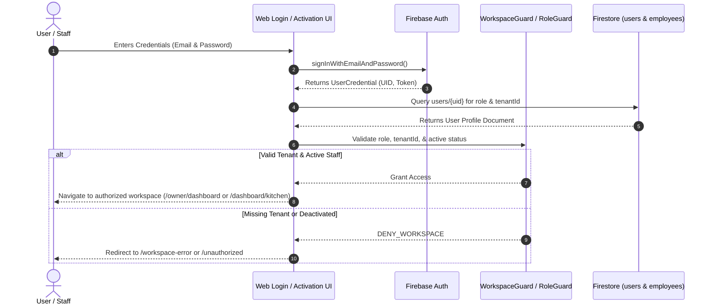
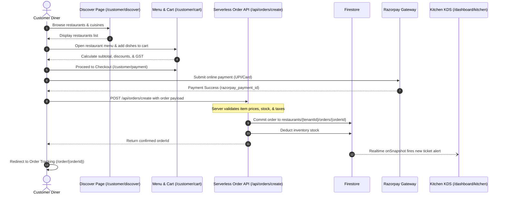
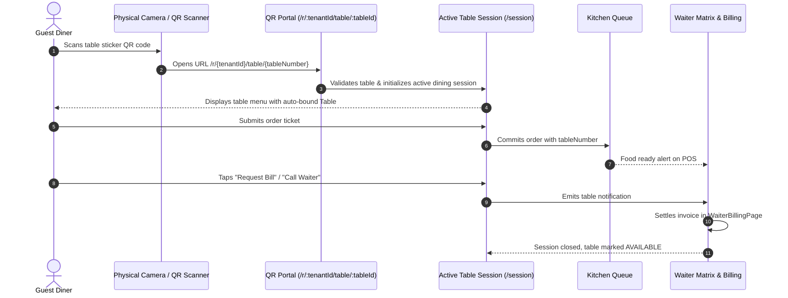
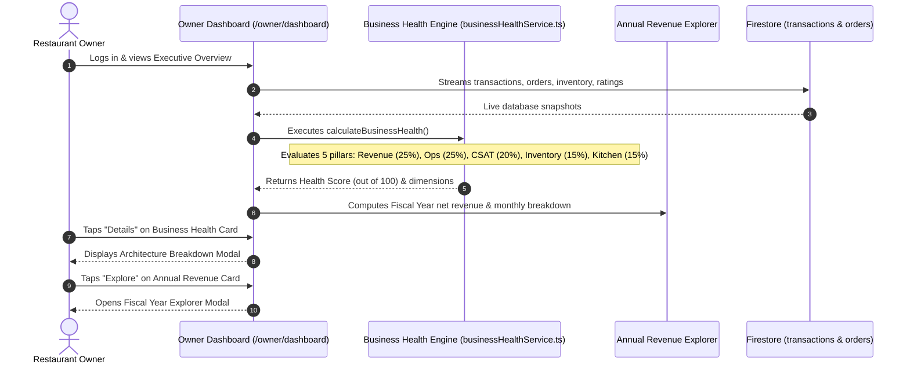
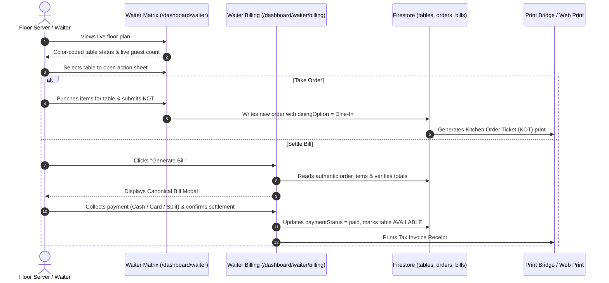

# SpiralDine Web Application — End-to-End Workflows
## Document 03: End-to-End Business Workflows

This document models and traces the complete multi-actor, multi-tenant workflows across the SpiralDine web application from user inception to system fulfillment.

---

### Workflow 1: User & Staff Authentication Lifecycle

#### Detailed Workflow Steps:
1. **Diner Registration & Session Restoration:**
   * Diner navigates to `/customer/register` or `/customer/login`.
   * Enters email/password or selects "Sign in with Google" (`signInWithPopup`).
   * On authentication success, `AuthContext` initializes listener on `users/{uid}`.
   * If user profile doesn't exist, a customer profile is committed with `{ role: 'customer', createdAt: serverTimestamp() }`.
   * `CustomerGuard` validates role and allows entry to `/customer/home`, `/customer/orders`, and `/customer/profile`.
2. **Staff Invitation & Cryptographic Onboarding:**
   * Owner opens `/owner/staff` and clicks "Invite Team Member".
   * Submits invite form (Name, Email, Role, Branch).
   * Client calls `/api/send-staff-invitation`. Serverless function generates HMAC token signed with server secret, writes document to `restaurants/{tenantId}/invitations/{token}`, and dispatches branded email via Resend API.
   * Employee clicks email link: `https://spiraldine.com/staff/activate?token=...`.
   * `/staff/activate` verifies token against `/api/verify-invitation`. Employee sets password.
   * System creates Firebase Auth user, assigns custom claims or writes `users/{uid}` with `{ role, tenantId, branchId }`, and transitions invitation state to `accepted`.
   * Staff member is automatically authenticated and routed to their work portal.
3. **Password Reset Flow:**
   * User navigates to `/forgot-password`, enters registered email address.
   * Client triggers `sendPasswordResetEmail(auth, email)`.
   * Firebase Auth delivers secure action link with OOB code.
   * User updates password and logs in.

---

### Workflow 2: Restaurant Discovery, Ordering & Payment (B2C)

#### Detailed Workflow Steps:
1. **Discovery & Item Selection:**
   * Diner searches by cuisine or geolocated distance on `/customer/discover`.
   * Clicks restaurant card $\rightarrow$ routes to `/customer/restaurant/:tenantId`.
   * Browses categories on `/customer/restaurant/:tenantId/menu`.
   * Selects dishes. If customizable, modal collects spice levels and add-ons.
   * Items added to `CartContext` stored in browser session.
2. **Checkout & Authoritative Order Validation:**
   * Diner reviews cart on `/customer/cart`, adds special kitchen instructions, applies promo code.
   * Navigates to `/customer/payment`. Chooses Dining Option (`Dine In`, `Takeaway`) and Payment Mode (`Online Gateway` or `Pay at Counter`).
   * If Online Payment: Razorpay SDK initiates modal. On capture, signature is verified.
   * Payload dispatched to `/api/orders/create`.
   * **Server-Side Security Check:** The backend retrieves live menu records from Firestore, re-calculates exact item costs, recalculates applicable percentage/fixed promo discounts, adds configured GST/service charge, and confirms transaction balance matches.
   * Order written to `restaurants/{tenantId}/orders/{orderId}` with status `PENDING`.
3. **Fulfillment & Real-Time Tracking:**
   * Kitchen line cooks receive real-time ticket on `KitchenQueue.tsx`.
   * Cook taps "Start Preparing" (status updates to `PREPARING`).
   * When cooking finishes, cook bumps ticket (status updates to `READY`).
   * Waiter delivers food to table (status updates to `SERVED`).
   * Customer tracking stepper on `/customer/restaurant/:tenantId/order/:orderId` synchronizes via Firestore `onSnapshot` without manual page reload.

---

### Workflow 3: Contactless QR Table Ordering

#### Detailed Workflow Steps:
1. **QR Scanning & Validation:**
   * Diner scans sticker on table using native phone camera or web QR scanner (`QrScannerModal.tsx`).
   * Route `/r/:tenantId/table/:tableId` mounts [`CustomerPortal.tsx`](file:///c:/Users/Geetha%20Krishna/OneDrive/Desktop/Project%20Saas%20for%20all/src/apps/customer/pages/CustomerPortal.tsx).
   * Validates `tenantId` exists in `restaurants` collection and table exists in `restaurants/{tenantId}/tables/{tableId}`.
   * Auto-binds table number into `CartContext` and sets dining option to `Dine-In`.
2. **Dining Session Maintenance:**
   * Diner orders multiple rounds of drinks or appetizers without re-entering details.
   * Live order status streams on [`ActiveDiningSessionPage.tsx`](file:///c:/Users/Geetha%20Krishna/OneDrive/Desktop/Project%20Saas%20for%20all/src/apps/customer/pages/ActiveDiningSessionPage.tsx).
   * Diner can tap "Call Waiter" (dispatches instant alert to `WaiterAlerts.tsx`) or "Request Bill".
   * Waiter brings POS terminal or accepts cash, marks bill settled on `WaiterBillingPage.tsx`, and closes the session.

---

### Workflow 4: Executive Owner Operations & Business Health

#### Detailed Workflow Steps:
1. **Real-Time Data Compilation:**
   * Upon mounting, `OwnerOverview.tsx` (Desktop) or `MobileHomeDashboard.tsx` (Mobile) establishes real-time Firestore listeners for:
     * `restaurants/{tenantId}/transactions` (limit 500)
     * `restaurants/{tenantId}/orders` (limit 500)
     * `restaurants/{tenantId}/inventory`
     * `restaurants/{tenantId}/satisfactionRatings` (limit 100)
2. **Canonical Business Health Calculation:**
   * Reused service [`calculateBusinessHealth()`](file:///c:/Users/Geetha%20Krishna/OneDrive/Desktop/Project%20Saas%20for%20all/src/shared/services/businessHealthService.ts) executes across 5 operational pillars:
     1. **Revenue Health (25%)**: 7-day transaction pace, gross revenue consistency, AOV integrity.
     2. **Operations Health (25%)**: Order completion rate vs cancellation rate, delayed orders.
     3. **Customer Health (20%)**: Diner CSAT survey ratings, sentiment averages.
     4. **Inventory Health (15%)**: Active ingredients count, out-of-stock / 86'd items.
     5. **Kitchen Health (15%)**: Preparation times against standard SLA targets.
   * If a dimension lacks minimum transaction history (e.g., $< 3$ orders), it is labeled `insufficient_data` and its baseline weight is dynamically renormalized so the owner's score is never penalized by missing historical data.
3. **Annual Revenue Explorer:**
   * Calculates current fiscal year based on April 1st boundary ($M \ge 3 \implies \text{Year}-\text{NextYear}$; $M < 3 \implies \text{PrevYear}-\text{Year}$).
   * Filters confirmed transactions to the selected FY window.
   * Computes Gross, Tax (GST), Net ($\text{Gross} - \text{Tax}$), and Average Monthly Revenue.
   * Maps 12 fiscal months (April through March) with percentage trend compared to the preceding month.

---

### Workflow 5: Staff Table Management & POS Billing (Waiter / Cashier)

#### Detailed Workflow Steps:
1. **Floor Management:**
   * Server logs in at `/staff/login`, routes to `/dashboard/waiter`.
   * Floor matrix displays live table cards with assigned waiter badges and elapsed seating time.
2. **Order Taking & KOT Dispatch:**
   * Waiter taps table card, opens order taking modal.
   * Adds dishes requested verbally by guests.
   * Submitting writes order to `restaurants/{tenantId}/orders`.
   * Kitchen KDS chimes immediately.
3. **Canonical Bill Settlement:**
   * Waiter opens `WaiterBillingPage.tsx` or taps "Settle Bill".
   * System mounts [`CanonicalBillModal.tsx`](file:///c:/Users/Geetha%20Krishna/OneDrive/Desktop/Project%20Saas%20for%20all/src/shared/ui/billing/CanonicalBillModal.tsx).
   * Computes subtotal, GST (e.g. 5%), service charge (optional), and discounts.
   * Supports multi-tender payment: Cash, Card, UPI, or Split tender.
   * Commits invoice to `restaurants/{tenantId}/bills` and creates confirmed transaction record in `restaurants/{tenantId}/transactions`.
   * Marks table status back to `AVAILABLE`.
