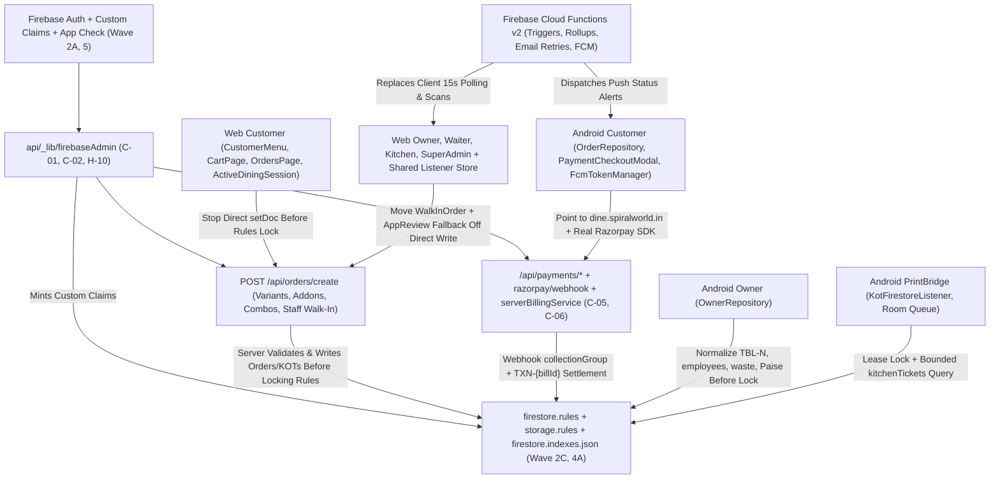

# SpiralDine Cross-Platform Dependency & Firestore Operations Map

**Governance Anchor**: Prerequisite for Wave 2 (`C-01`–`C-06`, `M-02`) and Wave 3 (`H-01`, `H-05`, `M-09`).  
**Rule Principle**: No `firestore.rules` lockouts may ship until every client operation listed below has been migrated to its safe canonical target or preserved under explicitly validated authenticated scope.

---

## 1. Cross-Platform Component Dependency Map

---

## 2. Complete Pre-Tightening Firestore Operations Inventory (Web + API + Android)

*Derived directly from repository inspection of `src/`, `api/`, `functions/`, `firestore.rules`, and `android/` (`887` Web/API call sites + `417` Android call sites).*

### A. Root-Level Collections

| Root Collection | Current Web / API Operations | Current Android Operations | Current Rules Vulnerability | Safe Target Operation Before Rules Lockdown |
| :--- | :--- | :--- | :--- | :--- |
| **`tenants/{id}`** | Public Read (`CustomerHome`, `DiscoverPage`, `TableBooking`, `CustomerMenu`); Write (`SuperAdminApplications` + `review-application.ts`, `OwnerSettings`, `WorkspaceContext` self-heal). | Read (`RestaurantRepository`, `OwnerRepository`, `PrintBridge`); Write (`OwnerRepository` status/plan). | `allow write` checks mutable `ownerUid` or broad role without strict field whitelist (`C-03`). | Public read (or clean `publicRestaurants` projection); writes **Admin SDK / Super Admin / strictly safe owner settings only** (`status`/`planTier` immutable to clients). |
| **`restaurants/{id}`** | Read & duplicate fallback source (`WorkspaceContext`, `api/orders/create`, `StaffActivate`, `SuperAdminTenants`); Write (`OwnerRestaurants`, `SuperAdminApplications` fallback). | Read & Write (`OwnerRepository`, `DiningSessionRepository`, `PrintBridge`). | Anyone signed in can pass `request.resource.data.ownerUid == auth.uid` to hijack ownership & set `'active'` (`C-03`). | Unify canonical metadata with `tenants/{id}` + Admin SDK-only provisioning/activation (`allow create, delete: if false` for clients). |
| **`users/{uid}`** | Read (`AuthContext`, `WorkspaceContext`, `StaffLogin`, `CustomerLogin`); Write (`OwnerStaffManager`, `StaffActivate`, `WorkspaceContext`). | Read (`FirebaseAuthManager`, `OwnerRepository`). | `allow read: if isAuth()` exposes all staff/owners cross-tenant; `allow create` allows claiming arbitrary `tenantId` + roles (`C-03`). | Strict self-read (`uid == auth.uid`) or `tenantId == token.tenantId` staff manager read; **writes via Admin SDK only** (`allow create, update, delete: if false`). |
| **`customers/{uid}`** | Read/Write (`CustomerLogin`, `CustomerMenu`, `CartPage`, `ProfilePage`, `Feedback`, `OwnerOverview:441`, `OwnerCustomers:91`); subcollections `orders`, `reservations`, `addresses`, `favorites`, `transactions`. | Read/Write (`CustomerRepository`, `OrderRepository`, `FcmTokenManager` `fcmTokens`, `OwnerRepository:1194`). | Any restaurant `'owner'`/`'admin'` can read/write ALL platform `customers` without `tenantId`; missing `userExists()` causes rule runtime error (`C-03`, `C-07`). | Customer reads/writes strictly `auth.uid == customerUid`; tenant CRM uses dedicated tenant subcollection `restaurants/{tenantId}/customers` populated server-side. |
| **`employees/{id}`** | Invite Read/Write (`invitationService.ts`, `OwnerStaffManager`, `MobileStaffManagement`, `StaffActivate`, `SuperAdminStaff`, `functions/`). | Read (`OwnerRepository.kt:235,255`, `PrintBridge` `FirebaseAuthManager.kt:252`). *(Android Owner also writes legacy `restaurants/{id}/staff`!)* | Unauth `get` & cross-tenant `list` leaks invitation tokens & staff PII; anyone can activate without token check (`C-03`). | **Server API only** for invite creation, token lookup, & account activation (`allow read: if token.tenantId == resource.data.tenantId \|\| isSuperAdmin()`, client write `false`). |
| **`owners/{uid}`** | Read (`roleResolver.ts:156`, `WorkspaceContext.tsx:101`). | None. | No explicit root rule in `firestore.rules` (defaults closed unless matched). | Keep read strictly `uid == auth.uid` if legacy doc remains, or migrate cleanly to `/users` + Custom Claims (`Wave 4A`). |
| **`restaurantApplications/{id}`** | Create/Read (applicant), Approve/Reject (`SuperAdminApplications` + `api/super-admin/review-application.ts`). | Read/Check during onboarding if applicable. | Secure JWT bypass in `review-application.ts` (`C-01`) + direct client fallback in UI (`C-05`). | Fix JWT crypto verification in `review-application.ts` (`C-01`), delete UI direct write fallback (`SuperAdminApplications.tsx:325`). |
| **`auditLogs` & `emailLogs`** | Create (`auditService`, `SuperAdminTenants`, `resendHelper.ts`). | Audit reads/writes (`OwnerRepository`). | `allow create: if isAuth()` lets any guest spoof audit/email logs; owners read platform audit logs (`C-03`). | `allow read: if token.role == 'super_admin'`; `allow write: if false` for all clients (Admin SDK / Cloud Functions only). |
| **`supportTickets`** | Create/Read (Customer), Manage (`SuperAdminSupport.tsx`). | Read/Create (`SupportTicketRepository`). | Broad update list (`customer` + `'admin'`, `'owner'`, `'manager'`, `'support'`). | Lock updates strictly to creator (close/reply safe fields) or authenticated `'super_admin'` / scoped support claim (`token.tenantId` if merchant ticket). |
| **`approvalNotifications` / `systemSettings` / `featureFlags`** | Read/Write (`SuperAdminApplications`, platform configs). | None currently wired. | Safe super-admin only, except inconsistent `'super-admin'` vs `'super_admin'` (`M-08`). | Canonicalize `super_admin` check (`token.role == 'super_admin'`). |

### B. Tenant Subcollections (`restaurants/{tenantId}/...`)

| Subcollection Path | Active Clients & Features | Known Divergence / Risk | Required Rule & Architecture Fix |
| :--- | :--- | :--- | :--- |
| **`menu/default/{categories,items,variants,addons,combos}`** | Customer Menu (Web+Android), Owner Menu Management, KDS availability toggle (`kitchenService.ts`), API pricing. | `kitchenService` role enums (`head_chef`, `line_cook`) mismatch rules (`kitchen`, `chef`, `M-02`); `KitchenQueue` decrements `availableServings` non-transactionally (`H-02`). | Public `read`; management write gated by `token.tenantId == tenantId && token.role in [...]`; align kitchen roles; make serving decrements transactional (`Wave 3`). |
| **`tables/{tableId}`** | QR Dining (`touchTableBrowsing`), Waiter Matrix, Floor Plan Editor, Settlement reset, Android Owner/Customer. | **Android Owner uses `T-N`; Web/API uses `TBL-N`** (`H-05`). Unauthenticated table tamper (`allow update` without `isAuth()` on `L340`). Billing writes `'cleaning'` vs `'Cleaning'`. | Require `isAuth()` on guest occupancy (`Browsing`/`Occupied`) scoped to active table token; unify `TBL-N` & `'Cleaning'` before locking; replace 45s pings (`M-03`). |
| **`orders/{orderId}`** | Customer Portal/Menu/Cart/Tracking, KDS, Waiter, Owner Billing/Analytics/Intelligence, Android Cust/Owner. | Direct `setDoc` writes in `CustomerMenu`, `WalkInOrderModal`, fallback services (`C-04`); non-transactional `items[]` overwrites (`H-01`); `6x` Web listeners (`H-06`). | Client `create` blocked for guests (`POST /api/orders/create` exclusively); `itemStates` transactional updates; shared ref-counted listener + `startAfter` cursors (`C-07`). |
| **`kitchenTickets/{ticketId}`** | Web KDS, Waiter drawer, Kitchen Print (`kotService`), Android PrintBridge (`KotFirestoreListener`). | Direct guest `create` permitted in rules (`L395`); KOT seq race (`M-05`); PrintBridge unbounded listener & duplicate print (`M-09`). | Block all client `create`/`delete` (written atomically by `/api/orders/create` & staff server POS); bounded status query + `printingLockedBy` lease txn for PrintBridge. |
| **`bills/{billId}`, `transactions/{id}`, `paymentAttempts/{id}`, `refunds/{id}`** | Web POS (`OwnerBilling`, `CanonicalBillModal`), Customer LiveBill/Payment, Razorpay `/create-order`, `/verify`, `/webhook`, Android Owner/Cust. | Unauth payment endpoints (`C-05`), `webhook.ts` non-`collectionGroup` (`C-06`), double-settlement race (`C-06`), Android double-paise `*100` & broken `COMPLETED` settle (`H-05`), rule `get()` amplification (`M-02`). | Server Admin SDK settlement (`TXN-${billId}` transaction), authenticated `/api/payments/*`, `collectionGroup` webhook index, Android Razorpay SDK, restrict client `transactions` writes. |
| **`waiterRequests/{id}` vs `requests/{id}`** | Web `CustomerPortal`, `ActiveDiningSessionPage`, `LiveDining`, `WaiterAlerts.tsx:179`, `WaiterMatrix.tsx:621`; Android `ServiceAssistanceRepository`, `OrdersScreen`. | Two sibling collections (`waiterRequests` and `requests`) open `allow read, create: if true` without `isAuth()` (`L494-504`). | Require `isAuth()` (`request.resource.data.customerId == request.auth.uid`) on create/read for diner + `isTenantStaff(tenantId)` for staff; consolidate `requests` -> `waiterRequests`. |
| **`diningSessions/{sessionId}`** | Customer multi-round QR tracking, table session lock, Android `DiningSessionRepository`. | Public `allow read: if true`; anyone can modify another guest's session (`L506-524`). | Require `isAuth()` + `customerId == auth.uid` (or valid table session verification) + `isTenantStaff(tenantId)`. |
| **`employees` vs `staff`** | Web `FirestoreService` maps `restaurants/{id}/employees`; `MobileStaffManagement` & Android Owner read/write **`restaurants/{id}/staff`** (`H-05`). | Split paths cause invisible staff rosters between Web and Android Owner! | Canonicalize `restaurants/{tenantId}/employees` (backed by server-managed invites); update Android Owner & Mobile Web before dropping compatibility rules. |
| **`waste` vs `wasteLogs`** | Web `inventoryService` uses `waste`; `MobileInventory.tsx:142` & Android Owner use **`wasteLogs`** (`H-05`). | `firestore.rules:574` explicitly locks `waste`; `wasteLogs` relies on fallback wildcard rule `L591` & diverges across platforms! | Standardize `restaurants/{tenantId}/waste` cleanly across Android Owner & `MobileInventory.tsx` alongside inventory permissions. |
| **`inventory`, `stockMovements`, `recipes`, `purchaseSuggestions`, `purchaseOrders`, `goodsReceipts`, `suppliers`, `supplierPrices`** | `OwnerInventoryManager`, `KitchenInventoryPage`, `PurchaseOrdersTab`, `VendorDirectoryTab`, `DashboardLayout` stock deductions, `OwnerRepository.kt`. | Non-transactional waste/serving deductions + $N$-tab transaction storms (`H-02`); unbounded `stockMovements` (`C-07`); `purchaseOrders`/`goodsReceipts`/`suppliers`/`supplierPrices` depend on wildcard `L591-598`. | **Explicitly enumerate** `purchaseOrders`, `goodsReceipts`, `suppliers`, `supplierPrices`, `purchaseSuggestions`, `recipes` in `firestore.rules` before restricting `L591` wildcard; paginate history. |
| **`floors`, `sections`, `floorPlans`, `branches`, `shifts`, `shiftClosingRequests`, `handovers`, `kitchenAnnouncements`, `kitchenShifts`, `preparedBatchesHistory`** | Waiter/FloorPlan UI, `WorkspaceContext`, Billing Shifts, Kitchen Shift & Prep Panels, Branch Transfers (`OwnerBranchTransfers`). | Rely largely on wildcard `L591` except `branches`; `branchId` often hardcoded `'main'`. | Explicitly list operational subcollections in `firestore.rules` with staff vs manager role granularity (`shifts` / `shiftClosingRequests` protected cleanly). |
| **`automationRules`, `automationSchedules`, `automationLogs`, `jobsHistory`, `campaigns`, `businessGoals`, `strategyPlans`, `dailyBriefs`, `aiRecommendations`, `reviews`, `satisfactionRatings`, `promotions`, `coupons`** | `OwnerAutomationCenter`, `OwnerMarketing`, `OwnerIntelligence`, `CustomerMenu` ratings/promos, Android Owner (`aiRecommendations`). | `satisfactionRatings` allows unauth `create` (`L530`); client `DashboardLayout` polls `automationRules`/`Schedules` every 15s (`H-02`); `promotions` has duplicate promo write (`M-05`). | Explicitly whitelist management/intelligence subcollections for `isTenantManager(tenantId)`; keep public `read` only for active `promotions`/`coupons`/`satisfactionRatings`; require `isAuth()` + order ownership on review create. |

---

## 3. Preservation Guarantees & Legacy Transition Order

To satisfy Execution Rules #5, #6, and #7 without disrupting live tenants or QR guests:
1. **Guest QR Ordering Remains Passwordless**: `ensureGuestAuth()` (Web) & `AuthRepository.signInAnonymously()` (Android) continue automatically signing in anonymous Firebase UIDs on `/r/:tenantId/t/:tableId`. Upgrading `/api/orders/create` happens **before** removing `CustomerMenu`/`OrderRepository` direct writes and tightening `firestore.rules`.
2. **No Blind Wildcard Removal**: Every management subcollection cataloged in Section 2B (`purchaseOrders`, `floorPlans`, `shifts`, `automationRules`, `campaigns`, `aiRecommendations`, etc.) MUST have explicit match rules deployed before closing the generic `L591-598` fallback match block.
3. **Android Compatibility Shim Window**: While upgrading Android APKs (`versionCode = 1 -> 2+`), backend endpoints and Cloud migration helpers accept both legacy `T-N` & canonical `TBL-N`, normalize currency calculation server-side, and enforce minimum version prompting before deprecating `staff`/`wasteLogs`.

